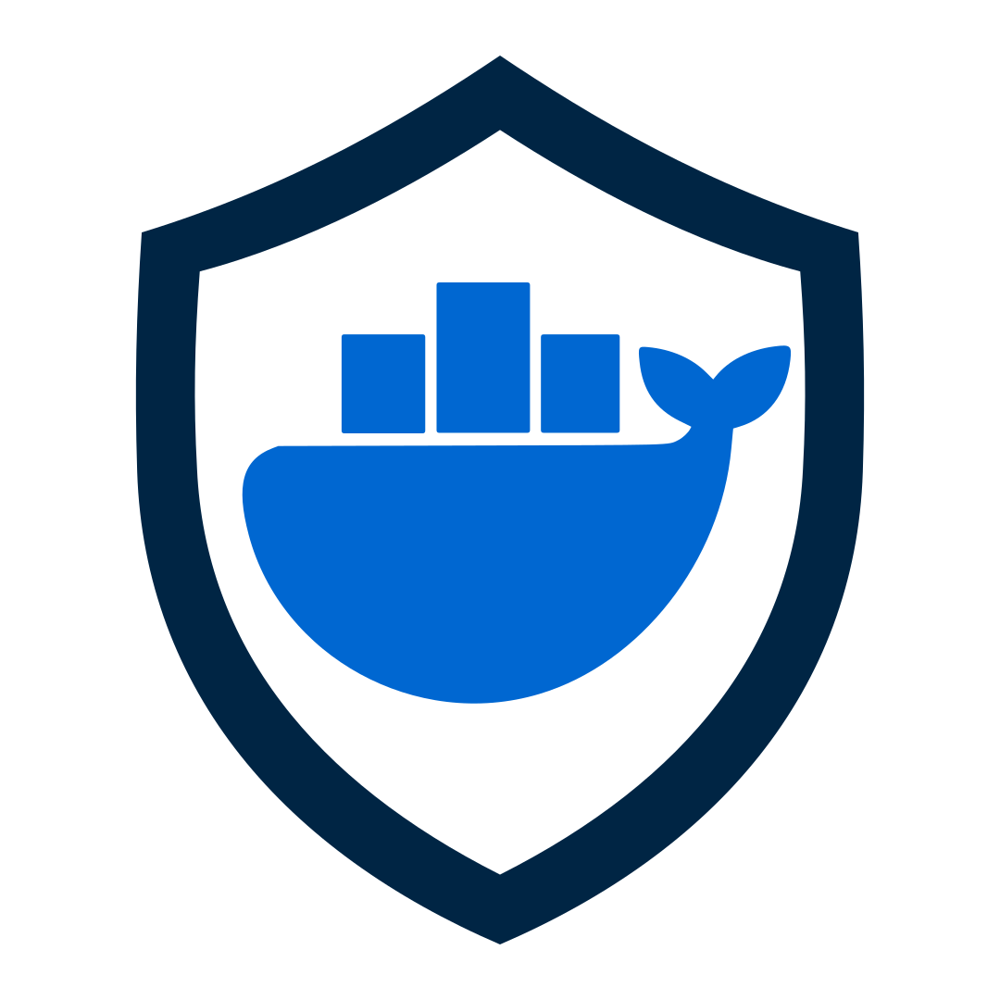

# Docktinel

<!-- Docktinel brand -->
<p align="center">
  
  
</p>
<!-- /Docktinel brand -->

A lightweight sentinel for Docker containers: startup checks, background jobs, helper process supervision, and a watchdog-aware healthcheck. Written in Go with no external runtime dependencies. Configure tasks with JSON or `docktinel add`.

## Contents

- [Quick start](#quick-start)
- [Add to your image](#add-to-your-image)
- [Configure tasks](#configure-tasks)
- [Health and recovery](#health-and-recovery)
- [Container requirements](#container-requirements)
- [Images and builds](#images-and-builds)
- [Documentation](#documentation)
- [License](#license)

## Quick start

Try the runnable HTTP example with Docker:

```sh
docker compose -f examples/basic/compose.yml up -d --build
curl http://127.0.0.1:8080
docker compose -f examples/basic/compose.yml exec demo docktinel status
```

The demo prepares a page, starts the server, waits for readiness, then runs health checks and a maintenance job. See [the demo guide](examples/basic/README.md) to simulate a failure and clean up.

## Add to your image

Copy the static binary into an image that contains your application and check commands. Replace the base image, application, and helper below with your own:

```dockerfile
FROM ghcr.io/xtrime-ru/docktinel:latest AS sentinel
FROM your-application:tag
COPY --from=sentinel /usr/local/bin/docktinel /usr/local/bin/docktinel
COPY docktinel.json /etc/docktinel/config.json
HEALTHCHECK --interval=10s --timeout=5s --start-period=2m --retries=3 \
  CMD ["docktinel", "healthcheck"]
ENTRYPOINT ["docktinel", "daemon"]
```

`docktinel.json`:

```json
{
  "tasks": [
    {
      "kind": "check",
      "name": "dependency",
      "phase": "both",
      "command": ["/usr/local/bin/check-dependency", "${DEPENDENCY_HOST}"],
      "timeout": "5s",
      "interval": "5s"
    },
    {
      "kind": "process",
      "name": "application",
      "phase": "startup",
      "on_exit": "restart-container",
      "command": ["application", "--foreground"]
    }
  ]
}
```

`both` runs the check before launch and during runtime. Set `DEPENDENCY_HOST` in the container environment and run with Docker's init and a restart policy, as shown [below](#container-requirements). For deployments, pin a version or image digest instead of `latest`.

## Configure tasks

| Task | Purpose | Default runtime behavior |
| --- | --- | --- |
| `check` | Test a dependency or the application | Stop the container after 3 consecutive failures |
| `job` | Run a one-shot or periodic command | Report degraded state and retry |
| `process` | Supervise a foreground helper | Restart the helper after exit |

Docktinel loads the config and runs startup tasks in order. After-start checks
verify readiness before runtime tasks begin. The default **2-minute budget**
covers startup and readiness. Set `DOCKTINEL_STARTUP_TIMEOUT` or
`daemon --timeout` to change it.

The daemon reads the config once. To change tasks, update the file and restart
the container. Use `DOCKTINEL_CONFIG` to select another file and `${VAR}` or
`${VAR:-default}` for ENV substitution.

Use `docktinel add` to create the file or add and update tasks before launch, for example
in a Dockerfile or an entrypoint. It accepts the same task options as the JSON
config. Pass an application command directly with `docktinel exec -- COMMAND`.
See [CLI configuration](docs/configuration.md#configure-with-the-cli).

Validate JSON, ENV substitutions and task settings without starting a daemon or executing commands:

```sh
docktinel config validate --config /etc/docktinel/config.json
```

See [configuration and ENV](docs/configuration.md) and the [command reference](docs/commands.md) for phases, defaults, deadlines and all options. Dependency probes and application-specific refresh logic remain your own commands.

## Health and recovery

Checks return zero on success and nonzero on failure. A success resets the failure counter; `successes` can require a streak before readiness or recovery is confirmed. Optional checks and jobs use `"failure": "degrade"` to keep the application running through failures. Jobs and helpers retry with capped exponential backoff and jitter. Jobs never overlap with themselves; `lock` serializes related tasks. See [retry and process policies](docs/commands.md#task-options) for details.

Docker healthcheck reads an atomic state file independently of the daemon's API. It checks heartbeat freshness, process/container identity and critical deadlines. On a critical watchdog fault, healthcheck signals Docktinel to shut down with a failure exit code. A later probe escalates to KILL after the grace period. Keep probes running for this protection to work.

| State | Docker healthcheck |
| --- | --- |
| Starting or stopping | Fails; allows the configured deadline/grace period |
| Fresh healthy or degraded runtime | Passes; optional failures do not cause restart loops |
| Stale watchdog or overdue critical task | Fails and initiates daemon shutdown |

**Docker does not restart a container merely because it is unhealthy.** Docktinel shuts down on critical failure, and Docker's restart policy brings the container back. Docker's healthcheck start period suppresses status penalties; probes and their side effects still run.

Inspect live state or diagnose health without sending signals:

```sh
docktinel status --json
docktinel healthcheck --no-kill
```

Lifecycle transitions and confirmed recovery are logged to stderr; task output goes to container stdout/stderr. Status omits command arguments and ENV values, but helper output may contain them.

## Container requirements

Docktinel runs **inside one Linux container**. Keep Docker's init for signal forwarding and zombie reaping:

```yaml
services:
  app:
    image: your-application-with-docktinel
    init: true
    restart: unless-stopped
    stop_grace_period: 30s
```

- Docktinel must be the direct child of Docker init. In a shell entrypoint, finish preparation with `exec docktinel daemon` or `exec docktinel exec -- application`.
- Run daemon, CLI and healthcheck as the same user, with permission to signal the daemon. For non-root images, set `DOCKTINEL_RUNTIME_DIR` to a writable private directory; the default is `/run/docktinel`. Keep it ephemeral and consistent across invocations.
- Helpers must stay in the foreground. Task cancellation terminates their process groups. Keep the control socket private; Docktinel does not need the Docker socket.
- When Docker sends TERM, Docktinel cancels running tasks and finishes its shutdown jobs before exiting. Set the container stop timeout to cover [task cancellation and shutdown jobs](docs/commands.md#daemon-and-lifecycle).

## Images and builds

The minimal `scratch` image contains `/usr/local/bin/docktinel`, statically linked for `linux/amd64` and `linux/arm64`. Copy it into Alpine, Debian or scratch application images. Helper commands, shells and CA certificates come from your application image.

Use `ghcr.io/xtrime-ru/docktinel:latest` or a published version tag. The [CI workflow](.github/workflows/ci.yml) defines publication and release tagging.

```sh
make image                            # build and load docktinel:local
GOOS=linux GOARCH=amd64 make build     # binary in bin/docktinel
make test                             # race tests and go vet on Linux
make integration                      # build demo and run Docker SDK tests
```

Source builds and tests require **Go 1.27+**. Docker builds include the toolchain. The main binary has no external Go dependencies; the Docker SDK is isolated in the integration test module. CI also produces Linux binaries and SHA256 checksums as workflow artifacts. See [Contributing](CONTRIBUTING.md) for development setup.

## Documentation

- [Command reference](docs/commands.md): task options, retries, shutdown and recovery.
- [Configuration and ENV](docs/configuration.md): schema, substitution and startup.
- [Local HTTP API](docs/api.md): control over a private Unix socket; healthcheck remains independent.
- [HTTP demo with JSON configuration](examples/basic/README.md) and [AdGuard Home configured via CLI](examples/adguard/README.md).
- [Contributing](CONTRIBUTING.md): development setup and test commands.

## License

Docktinel is released under the [MIT License](LICENSE).

The wordmark uses [Ubuntu Sans](https://github.com/canonical/Ubuntu-Sans-fonts), licensed under the [Ubuntu Font Licence 1.0](assets/Ubuntu-Font.txt).
